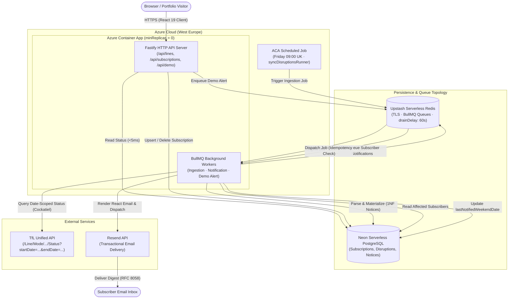

# RailSignal

> A London weekend transit closure tracker. Ingests Transport for London (TfL) engineering data, normalizes closures into structured notices, and sends Friday morning email digests alongside a high-contrast web dashboard.

[](https://www.typescriptlang.org/)
[](https://nodejs.org/)
[](https://fastify.dev/)
[](https://react.dev/)
[](https://tailwindcss.com/)
[](https://azure.microsoft.com/)
[](https://neon.tech/)
[](https://upstash.com/)
[](https://resend.com/)
[]()
[](https://vitest.dev/)

---

## 🌐 Live Application

* **Web Dashboard**: `https://railsignal.calmglacier-47209930.westeurope.azurecontainerapps.io` *(Pending Cloud Deployment — Phase 6B)*
* **API Health Check**: `https://railsignal.calmglacier-47209930.westeurope.azurecontainerapps.io/api/health`

> ℹ️ **Cold Starts**: The backend runs on Azure Container Apps with scale-to-zero (`minReplicas = 0`) to keep hosting 100% free. If idle, the first request takes ~10 seconds to spin up; subsequent requests respond in under 5ms.

---

## 📌 Problem & Overview

London commuters travel reliably during the working week, but weekend travel is often disrupted by planned engineering closures, station shutdowns, and replacement buses across the Tube, Elizabeth line, Overground, and DLR.

Standard journey apps only show real-time delays happening *right now*. Finding out what is closed this coming weekend usually requires hunting through TfL status menus.

**RailSignal** acts as an early-warning radar:
1. Watches the upcoming weekend window (**Friday 19:00 to Monday 04:30 London Time**, handling GMT/BST changes).
2. Pulls planned TfL engineering work, strips out temporary live incidents, and cleans up messy text descriptions into structured station notices.
3. Sends a Friday morning email summary to subscribers and powers a fast, high-contrast weekend status dashboard.

---

## ✨ Key Features

* **Weekend Closure Radar**: Looks ahead specifically at Friday 19:00 to Monday 04:30 London time. Ignores minor weekday delays and highlights planned weekend track closures.
* **Station-First Status Cards**: Closed routes sort to the top with clear station headlines (`Gospel Oak ↔ Stratford: No service`) and replacement bus stops. Unaffected lines stay compact below with `No Planned Closures`.
* **Friday Email Alerts & Demo Mode**: Sends a clean Friday morning summary via Resend. Visitors can also click **"Send Test Alert"** in the app to get an instant sample email in their inbox.
* **Fast & Accessible**: WCAG 2.1 AA compliant dark theme with official TfL colors (including a contrast border on the black Northern line). Fastify returns line status queries in under 5ms.
* **Strict £0/Month Budget**: Built to run entirely on free cloud tiers (Azure Container Apps, Neon Postgres, Upstash Redis, and Resend).

---

## 🏛️ System Architecture



---

## 🛠️ Tech Stack

| Component | Technologies |
| :--- | :--- |
| **Backend API** | Node.js 22 LTS, Fastify 5.x, TypeBox (`@sinclair/typebox`), Cockatiel (resilience) |
| **Database & ORM** | Prisma ORM 6.x, Neon Serverless PostgreSQL (production), SQLite (local dev) |
| **Background Jobs** | BullMQ 6.x, Upstash Serverless Redis (TLS), Resend API, `@react-email` |
| **Frontend UI** | React 19, TypeScript 5, Vite 6, Tailwind CSS 3.4, TanStack Query v5, Radix UI Dialog |
| **Testing & Tooling** | Vitest v4, React Testing Library, Mock Service Worker (MSW), Biome (lint & format) |
| **Cloud & DevOps** | Azure Container Apps (`minReplicas = 0`), Docker Multi-Stage Alpine, GitHub Actions |

---

## 📂 Repository Structure

```text
RailSignal/
├── packages/shared/   # Shared contracts, TypeBox schemas & London transit lines
├── backend/
│   ├── src/routes/    # Fastify API route plugins (health, lines, subscriptions, demo)
│   ├── src/workers/   # BullMQ background workers (ingestion, notifications, demo alerts)
│   ├── src/domain/    # Pure domain calculation (status board ranking, London weekend window)
│   ├── src/clients/   # Sealed TfL client facade with Cockatiel resilience
│   ├── src/email/     # Deep EmailClient, RFC 8058 deliverability headers, and React Email
│   └── prisma/        # Schema & migrations (SQLite local / PostgreSQL cloud)
├── client/
│   └── src/           # React 19 single-page app (Clean Transit Radar, Radix UI dialogs)
└── docs/adr/          # Architectural Decision Records (ADRs 0001–0008)
```

---

## ⚙️ Engineering Decisions & Trade-offs

* **Pre-Parsing Notices on Ingestion ([ADR 0008](docs/adr/0008-materialized-disruption-notices.md))**: TfL disruption text is a wall of messy sentences. Instead of parsing it on every page load with slow regular expressions, we parse it once when saving to the database. Status queries respond in under 5ms.
* **Single Container with Scale-to-Zero ([ADR 0003](docs/adr/0003-bullmq-upstash-quota-and-scale-to-zero.md))**: Running separate containers for the API and queue workers would double hosting costs. We host Fastify and BullMQ in one Node.js process on Azure Container Apps, which scales to zero when idle and costs £0.
* **Dual Database Setup (SQLite + Postgres) ([ADR 0002](docs/adr/0002-prisma-dual-persistence.md))**: Prisma locks you into one database provider in `schema.prisma`. A quick build script swaps `sqlite` to `postgresql` in Docker and CI, letting developers run locally with a zero-setup SQLite file while production runs on serverless Postgres.
* **Email Client & 1-Click Unsubscribe ([ADR 0007](docs/adr/0007-deep-email-delivery-client.md))**: We use `@react-email` for mobile-friendly emails and preview them locally with `npm run email:dev`. Outgoing emails include RFC 8058 `List-Unsubscribe` headers to comply with 2024 Gmail and Yahoo delivery rules.
* **Shared Types with TypeBox ([ADR 0005](docs/adr/0005-typebox-validation-and-shared-contracts.md))**: Instead of maintaining separate TypeScript types for the React client and JSON schemas for Fastify, we use TypeBox in `packages/shared`. One schema validates API requests and types the React client with zero code generation.

---

## 📡 API Endpoints

| Method | Endpoint | Description |
| :--- | :--- | :--- |
| `GET` | `/api/health` | Health check probe. |
| `GET` | `/api/lines/weekend-status` | Materialized weekend transit closures and station notices (<5ms). |
| `POST` | `/api/subscriptions` | Subscribe an email address to specific London transit lines. |
| `DELETE` | `/api/subscriptions/:id?token=...` | Unsubscribe from alerts using secure token. |
| `POST` | `/api/demo/send-test-digest` | Instant demo alert enqueued for portfolio evaluators. |
| `POST` | `/api/jobs/sync-weekend-disruptions` | Protected manual sync endpoint (`X-Job-Secret`). |

---

## 🚀 Local Development

No Docker, local Redis, or cloud accounts are required to run this project locally.

### Quick Start (4 Steps)

```bash
# 1. Clone repository
git clone https://github.com/Foysal94/RailSignal.git
cd RailSignal

# 2. Install dependencies
npm install

# 3. Copy environment file and initialize local SQLite database
cp backend/.env.example backend/.env
npm run build:shared
npx prisma migrate dev --schema=backend/prisma/schema.prisma

# 4. Start backend API and React client
# Terminal 1: Fastify API (http://localhost:3000)
npm run dev

# Terminal 2: React UI (http://localhost:5173)
npm run dev --workspace=@railsignal/client
```

* **No Email Key Needed**: If `RESEND_API_KEY` is blank, outgoing emails log directly to your terminal.
* **Visual Email Designer**: Run `npm run email:dev` to preview and edit email templates in your browser.

---

## 🧪 Testing

The test suite runs **226 automated tests** (151 backend, 75 client) in under 12 seconds with zero network access.

```bash
# Run all tests across the monorepo
npm test

# Run TypeScript typechecks
npm run typecheck

# Run Biome linting
npm run lint
```

Backend integration tests use Fastify's in-memory `app.inject()` and a temporary SQLite database (`test.db`). Client component tests use React Testing Library and Mock Service Worker (MSW) to intercept network calls without mocking `fetch`.